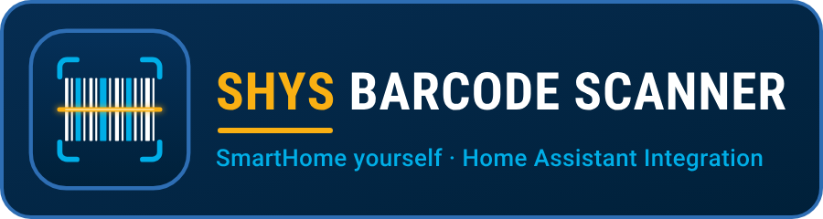
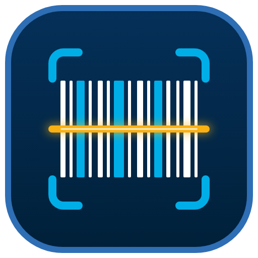

<p align="center">
  
</p>

<p align="center">
  <a href="https://www.home-assistant.io/integrations/marketplace/"></a>
  <a href="https://github.com/kallejoken/shys-barcode-scanner/releases"></a>
  
</p>

# SHYS Barcode Scanner für Home Assistant

**Scannen. Fertig. Steht auf der Einkaufsliste.**
Die selbstlernende Barcode-Datenbank für den [ESPHome-Barcode-Scanner von SmartHome yourself](https://github.com/SmartHome-yourself/barcode-scanner-for-esphome).
Unbekannte Produkte lernst du einmal an, danach kennt Home Assistant sie für immer, auch ohne Internet.

> [!NOTE]
> **Test-Repo:** Dieses Repository unter `kallejoken` ist die öffentliche Testversion.
> Nach der Testphase zieht die Integration zu [SmartHome-yourself](https://github.com/SmartHome-yourself) um.
> Wir sagen rechtzeitig Bescheid, dann einfach das neue Repo im Marketplace eintragen.

## Installation über den Home Assistant Marketplace in 3 Schritten

Seit Home Assistant 2026.11 ist der **Marketplace** (ehemals HACS) direkt eingebaut – du musst nichts extra vorinstallieren.

**1. Repository im Marketplace hinzufügen**

[](https://my.home-assistant.io/redirect/hacs_repository/?owner=kallejoken&repository=shys-barcode-scanner&category=integration)

Ein Klick auf den Button öffnet das Repository direkt im Marketplace deines Home Assistant.
Ohne Button: *Einstellungen → Marketplace → oben rechts „Über Link hinzufügen“* →
`kallejoken/shys-barcode-scanner` (oder die volle GitHub-URL) eintragen → *Hinzufügen*.
*(Auf älteren HA-Versionen vor 2026.11: über HACS → Benutzerdefinierte Repositories, Kategorie **Integration**.)*

**2. Installieren & neu starten**

Im Marketplace **SHYS Barcode Scanner** öffnen → *Installieren* → Home Assistant neu starten
(*Einstellungen → System → oben rechts ⏻ → Home Assistant neu starten*).

**3. Integration hinzufügen & Liste wählen**

*Einstellungen → Geräte & Dienste → Integration hinzufügen → „SHYS Barcode Scanner“* →
deine Ziel-`todo`-Liste auswählen, z. B. `todo.shopping_list`, **Bring!** oder den **Picnic**-Warenkorb. Fertig – einfach scannen!

<details>
<summary>Manuelle Installation ohne Marketplace</summary>

Ordner `custom_components/shys_barcode_scanner` nach `<config>/custom_components/` kopieren und Home Assistant neu starten.
</details>

## Das kann die Integration

- 🧠 **Selbstlernende lokale Datenbank:** Jeder Treffer wird gespeichert. Ab dem zweiten Scan läuft das Produkt komplett offline und mit deinem eigenen Namen.
- 🇩🇪 **Deutscher Offline-Katalog (neu in 1.4.0):** Rund 380.000 in Deutschland erhältliche Produkte (Lebensmittel, Drogerie, Haushalt, Tierfutter) per Klick lokal in Home Assistant laden – Scans werden danach in unter 1 ms **ohne Internet** erkannt.
- 🔎 **Automatische Produktsuche:** Offline-Katalog → Open Food Facts → ean-suche.net → optional OpengtinDB. Einzeln abschaltbar.
- ✍️ **Anlern-Modus:** Unbekannte Codes landen in der Seitenleiste unter *Unbekannte Scans*. Name eintippen, fertig.
- 📲 **Direkt-Antwort per Push:** Unbekannter Code? Die Home-Assistant-App meldet sich, du tippst den Produktnamen direkt in die Benachrichtigung – gespeichert und auf der Liste, ohne die App zu öffnen. Funktioniert auf iOS und Android.
- 👨‍👩‍👧 **Mehrere Handys (seit 1.2.0):** Beliebig viele `notify.mobile_app_*`-Dienste auswählen. Sobald jemand antwortet oder verwirft, verschwindet die Nachricht auf allen Handys. Optional nur an Personen senden, die Home Assistant als *Zuhause* erkennt.
- ↩️ **Rückgängig (neu in 1.3.0):** Einen versehentlichen Scan im Panel beim *Letzten Scan* mit **Rückgängig** wieder von der Liste nehmen. Optional gibt es dazu eine kurze Erfolgs-Push mit demselben Button – standardmäßig aus, damit bekannte Scans nicht stören.
- 🛒 **Listenwahl in der Push-Antwort (neu in 1.3.0):** Zusätzliche Schnell-Listen festlegen, dann erscheinen in der Unbekannt-Nachricht zwei Antwort-Buttons (Standard-Liste und erste Zusatz-Liste) plus *Verwerfen*. Alternativ hängst du in der Antwort `@Listenname` an, z. B. `Spülmittel @Drogerie`.
- 🗂️ **Eigenes Panel „Barcode Scanner“** in der Seitenleiste: Produkte suchen, umbenennen, löschen, eigene Codes für lose Ware oder QR-Sticker anlegen, Test-Scan, JSON-Export und -Import.
- 📝 **Jede `todo`-Liste als Ziel**, auch pro Produkt (z. B. Drogerie auf eine eigene Liste).
- ➕ **Duplikat-Schutz:** Trotzdem nochmal eintragen, überspringen oder Menge hochzählen (`2x Milch`).
- 🔔 **Rückmeldung an den Scanner:** Produktname aufs OLED und passender Piep-Ton (gefunden / unbekannt / Fehler).
- 📊 **Sensoren, Aktionen & Event** für eigene Automationen und Dashboards.
- 💾 **Im HA-Backup enthalten:** Die Datenbank liegt in `<config>/.storage/shys_barcode_scanner`. Der Offline-Katalog liegt getrennt in `<config>/shys_barcode_scanner_catalog.db` und lässt sich jederzeit neu laden.

## So läuft ein Scan ab

1. Der Scanner (ESPHome-Firmware v3) schickt den Code als Event `esphome.barcode_scanned` an Home Assistant.
2. **Eigene Produktdatenbank zuerst:** Bekannte Codes gehen sofort und ohne Internet auf die Liste – eigene bzw. angelernte Namen haben immer Vorrang.
3. **Offline-Katalog:** Ist der deutsche Offline-Katalog geladen, wird die EAN dort lokal nachgeschlagen (< 1 ms, kein Internet). Nur der gescannte Artikel wird in deine Produktdatenbank übernommen (Quelle *Offline-Katalog*), damit du ihn dort umbenennen oder einer eigenen Liste zuordnen kannst.
4. **Online-APIs:** Nur wenn der Offline-Katalog nichts kennt (und die APIs eingeschaltet sind). Treffer werden ebenfalls lokal gespeichert, das System lernt also mit.
5. **Gar nichts gefunden:** Der Code wartet unter **Unbekannte Scans** aufs Anlernen – oder du antwortest direkt auf die Push-Nachricht.
6. Der Scanner piept und zeigt das Ergebnis an.

Ändert sich mal eine API, reicht ein Update über den Marketplace. Der ESP muss nicht neu geflasht werden.

## Das Panel in der Seitenleiste

| Bereich | Wofür |
|---|---|
| Unbekannte Scans | Letzten Scan inkl. **Rückgängig**, Namen für unbekannte Codes vergeben („Speichern & auf Liste“) oder verwerfen |
| Produktdatenbank | Suchen, umbenennen, löschen, eigene Codes für lose Ware/QR-Sticker anlegen, Ziel-Liste pro Produkt |
| Test & Backup | Test-Scan ohne Scanner, JSON-Export und -Import |
| Offline-Katalog | Deutschen Offline-Katalog per Kategorie laden, aktualisieren, löschen und offline darin suchen („Auf Einkaufsliste“ / „In eigene DB übernehmen“) |
| Einstellungen | Alle Integrations-Optionen inkl. Push-Handys und **Test-Push** – derselbe Datenstand wie unter *Konfigurieren* |

## Optionen (alles optional)

Die Einstellungen erreichst du direkt im Panel unter **Einstellungen** (inkl. einem **Test-Push**, um die Handy-Benachrichtigungen zu prüfen). Alternativ: *Geräte & Dienste → SHYS Barcode Scanner → Konfigurieren*. Beide Wege schreiben dieselben Integrations-Optionen und bleiben synchron.

| Option | Standard | Bedeutung |
|---|---|---|
| Standard-Liste | `todo.shopping_list` | Jede `todo.*`-Liste |
| Zusätzliche Schnell-Listen | leer | Optionale weitere `todo`-Listen für die Push-Antwort bei unbekannten Codes |
| Schon auf der Liste | Menge hochzählen | `Trotzdem nochmal` / `Nicht nochmal` / `2x, 3x …` |
| Unbekannte Codes | Nur zum Anlernen merken | Optional zusätzlich den Code auf die Liste setzen |
| Text auf der Liste | Marke + Produkt | oder nur Produkt (Marke wird nie doppelt geschrieben) |
| Lokalen Offline-Katalog nutzen | an | Scans zuerst im heruntergeladenen deutschen Offline-Katalog suchen |
| Open Food Facts / ean-suche.net | an | Online-Datenquellen einzeln abschaltbar |
| OpengtinDB-QueryID | leer | Eigene ID von <https://opengtindb.org/userid.php> |
| Handys für Benachrichtigungen | leer | Mehrfachauswahl, z. B. `notify.mobile_app_mein_handy` und `notify.mobile_app_pixel_frau` (mit Direkt-Antwort, siehe unten) |
| Nur an anwesende Personen senden | aus | Push nur an Handys, deren Person bzw. Gerät als *Zuhause* erkannt wird |
| Kurze Erfolgs-Nachricht mit Rückgängig-Button | aus | Nach einem bekannten Scan eine kurze Push mit **Rückgängig** senden (respektiert den Anwesenheitsfilter) |
| User-Agent | SHYSBarcodeScanner/1.0 … | Open Food Facts wünscht `AppName/Version (deine-mail@example.com)` |
| ESPHome-Gerät für Rückmeldung | leer | Nur nötig, wenn das Event keinen Gerätenamen mitschickt |
| Adresse des Offline-Katalogs | leer (= GitHub-Release `offline-catalog-de`) | Nur nötig, wenn der Katalog woanders gehostet wird |

## Deutscher Offline-Katalog (100 % unabhängig von APIs)

Ab Version 1.4.0 kannst du einen kompletten deutschen Produktkatalog direkt in Home Assistant ablegen. Danach erkennt der Scanner bekannte Markenprodukte **ohne Internet, ohne API-Limits und in unter einer Millisekunde**.

**So geht's:** Seitenleiste → **Barcode Scanner** → Tab **Offline-Katalog** → Kategorien anhaken → **Katalog laden**. Fertig.

| Kategorie | Quelle | Produkte* | Download* |
|---|---|---:|---:|
| Lebensmittel & Getränke | [Open Food Facts](https://world.openfoodfacts.org) | ca. 372.000 | ca. 5,2 MB |
| Drogerie & Kosmetik | [Open Beauty Facts](https://world.openbeautyfacts.org) | ca. 6.500 | ca. 0,1 MB |
| Haushalt & Alltag | [Open Products Facts](https://world.openproductsfacts.org) | ca. 4.000 | ca. 0,1 MB |
| Tierfutter | [Open Pet Food Facts](https://world.openpetfoodfacts.org) | ca. 1.400 | < 0,1 MB |

\* Stand November 2026. Alle vier Kategorien zusammen belegen als SQLite-Datei rund 21 MB.

- **Nur deutsche Produkte:** Übernommen werden nur Einträge, die in den Datenbanken als in Deutschland erhältlich markiert sind (`en:germany`), mit gültiger EAN-8/EAN-13 (Prüfziffer geprüft) und einem echten Produktnamen. Gespeichert werden nur EAN, Marke und Name – keine Bilder, Nährwerte oder Zutaten.
- **Getrennt von deiner Datenbank:** Der Katalog liegt als eigene SQLite-Datei unter `<config>/shys_barcode_scanner_catalog.db` – nicht in `.storage`. Deine persönliche Produktliste und das HA-Backup bleiben dadurch klein. Erst wenn du einen Artikel tatsächlich scannst, landet genau dieser eine Artikel in deiner Produktdatenbank.
- **Sicher aktualisieren:** Jede Datei wird gegen die SHA256-Prüfsumme aus dem Manifest geprüft, die neue Datenbank wird komplett aufgebaut und erst dann atomar ausgetauscht. Laufende Scans sehen nie einen halben Katalog. Abgewählte Kategorien verschwinden beim nächsten Laden.
- **Monatlich frisch:** Eine GitHub Action baut den Katalog jeden Monat (am 1. um 03:00 UTC) neu aus den offiziellen Datenbank-Exporten und legt ihn im Release [`offline-catalog-de`](https://github.com/kallejoken/shys-barcode-scanner/releases/tag/offline-catalog-de) ab. Mit **Nach Updates prüfen** siehst du im Panel, ob es einen neueren Stand gibt.
- **100 % offline:** Im Tab **Einstellungen** „Lokalen Offline-Katalog nutzen“ an- und *Open Food Facts* sowie *ean-suche.net* ausschalten. Unbekannte Codes landen dann wie gewohnt unter *Unbekannte Scans* bzw. in der Push-Antwort.

Selbst bauen (z. B. für einen eigenen Spiegel): `python3 scripts/build_offline_catalog.py --out dist/catalog` – nur Python-Standardbibliothek, die Exporte werden gestreamt und nicht auf der Platte zwischengespeichert.

**Lizenz & Quellenangabe:** Die Katalogdaten enthalten Informationen aus [Open Food Facts](https://world.openfoodfacts.org), [Open Beauty Facts](https://world.openbeautyfacts.org), [Open Products Facts](https://world.openproductsfacts.org) und [Open Pet Food Facts](https://world.openpetfoodfacts.org) (Datenbank: [Open Database License (ODbL) 1.0](https://opendatacommons.org/licenses/odbl/1-0/), Einzelinhalte: [Database Contents License (DbCL) 1.0](https://opendatacommons.org/licenses/dbcl/1-0/)). Die abgeleiteten Offline-Katalogdateien werden ebenfalls unter ODbL 1.0 weitergegeben (Share-Alike gilt ausschließlich für die Katalogdateien; der Quellcode der Integration steht unter der [MIT-Lizenz](LICENSE)).

## Push-Nachricht mit Direkt-Antwort

1. Home-Assistant-App (iOS oder Android) auf den Handys einrichten.
2. *Geräte & Dienste → SHYS Barcode Scanner → Konfigurieren* → unter **Handys für Benachrichtigungen** eines oder mehrere Geräte aus der Liste wählen (eigene Notify-Gruppen kannst du zusätzlich eintippen).
3. Optional den Haken **Nur an anwesende Personen senden** setzen, wenn die Nachricht nur an Leute gehen soll, die Home Assistant gerade als *Zuhause* sieht.

Bei jedem neuen unbekannten Code kommt dann **„Unbekannter Barcode“** auf die ausgewählten Handys:

| In der Nachricht | Was passiert |
|---|---|
| **Produkt benennen** | Textfeld direkt in der Benachrichtigung (iOS: lange drücken bzw. nach unten ziehen, Android: aufklappen). Produktname eintippen, absenden: Das Produkt wird in der lokalen Datenbank gespeichert und auf die Standard-Liste gesetzt (Duplikat-Einstellung gilt). Die Nachricht verschwindet danach. |
| **→ Listenname** (optional) | Wenn unter *Zusätzliche Schnell-Listen* mindestens eine weitere Liste gewählt ist, ersetzt das die einzelne „Produkt benennen“-Aktion: Button 1 ist die Standard-Liste, Button 2 die erste Zusatz-Liste, plus **Verwerfen** (maximal 3 Buttons, damit Android nichts abschneidet). Das Produkt wird mit dieser Ziel-Liste gespeichert und direkt dort eingetragen. |
| **Verwerfen** | Code aus *Unbekannte Scans* entfernen |
| Auf die Nachricht tippen | Öffnet direkt das Panel **Barcode Scanner** |

Zusätzlich kannst du in jeder Antwort `@Listenname` anhängen, z. B. `Spülmittel @Drogerie`. Das funktioniert auch dann, wenn mehr als zwei Listen im Spiel sind.

Sobald jemand in der Push-Nachricht antwortet oder verwirft – oder du denselben Code im Panel auflöst bzw. verwirfst – wird die Nachricht automatisch auf **allen** konfigurierten Handys ausgeblendet.

Optional (Haken *Kurze Erfolgs-Nachricht mit Rückgängig-Button*): Nach einem bekannten Scan kommt eine kurze Push **„Auf der Einkaufsliste“** mit einem Button **Rückgängig**. Derselbe Button steht im Panel beim *Letzten Scan*.

Technisch: Die Unbekannt-Nachricht trägt den Tag `shys_barcode_<ean>` und die Aktionen `SHYS_REPLY_<ean>` bzw. `SHYS_REPLY_L0_<ean>` / `SHYS_REPLY_L1_<ean>` und `SHYS_DISMISS_<ean>`. Die optionale Erfolgs-Push nutzt `shys_barcode_ok_<undo_id>` und `SHYS_UNDO_<undo_id>`. Die Integration reagiert nur auf diese, `REPLY`-Aktionen deiner anderen Automationen bleiben unberührt. Ein bereits bekannter Code, der von zwei Handys fast gleichzeitig beantwortet wird, wird nur einmal gelernt.

## Unterstützte Einkaufslisten (Bring!, Picnic & Co.)

Es funktioniert **jede** Integration in Home Assistant, die eine `todo`-Liste anbietet – zum Beispiel:

- **Home Assistant Einkaufsliste / Lokale To-do-Listen** (komplett offline)
- **Bring!** (offizielle Home-Assistant-Integration)
- **Picnic** (Warenkorb direkt als `todo`-Liste)
- **Todoist**, **Google Tasks**, **Microsoft To Do**, **CalDAV** (z. B. Nextcloud Tasks), **Mealie**

Über die optionale Ziel-Liste pro Produkt im Panel lassen sich auch mehrere Listen parallel nutzen (z. B. Lebensmittel an Bring!/Picnic und Drogerie auf eine eigene Liste).

**Hinweis zu [Picnic](https://www.home-assistant.io/integrations/picnic/):**
- Picnic sucht nach dem Text auf der Liste. Trifft es mal das falsche Produkt, benennst du den Eintrag in der Produktdatenbank einmal passend um.
- Der Picnic-Warenkorb kann Einträge nicht umbenennen. Beim „Menge hochzählen“ wird das Produkt deshalb einfach nochmal hinzugefügt.

## ESPHome-Firmware v3

Die Integration braucht die schlanke Scanner-Firmware **v3**: Der ESP32 liest nur noch den GM60 aus und schickt den Code an Home Assistant. Kein HTTP, kein JSON, keine API-Keys auf dem ESP.

- Event an HA: `esphome.barcode_scanned` (`ean`, `device`)
- Rückmeldung von HA: Aktion `esphome.<name>_show_result` (OLED-Text + Piep)
- Buzzer zur Auswahl: `packages/buzzer-passive.yaml` (passiver Piezo, Töne per RTTTL), `packages/buzzer-active.yaml` (aktiver Piezo) oder `packages/buzzer-none.yaml`
- Optional: `packages/display.yaml` (OLED SSD1306 128×64)

Die Geräte-YAML und alle Details stehen in der `README-HACS.md` des ESPHome-Repos.

## GM60 richtig einstellen

Ab Werk steht der GM60 auf einem trägen Lesemodus: Man muss ihn hin- und herbewegen, bis er etwas liest.
Das stellst du einmalig mit den Einstellungs-Codes aus dem **[GM60-Handbuch (PDF)](https://www.mikroshop.ch/pdf/GM60Reader.pdf)** um.
Am Bildschirm so weit reinzoomen, dass nur ein Code zu sehen ist (oder die Seiten ausdrucken).
Die Seitenzahlen sind die unten auf der Seite gedruckten, im PDF-Viewer jeweils Seite +4.

1. **Seite 19** (2.2 Setup Code): „Setup code on“
2. **Seite 22** (4.1 Continuous Mode): „Continuous Mode“ und darunter bei *Single Read Time* „Infinite“
3. **Seite 26/27** (5.1 Breathing Lamp): „Breathing lamp 1-White“ (Code oben auf Seite 27). Weißes Licht statt Farbwechsel, das gibt deutlich mehr Kontrast. Alternativ „Normal“ (Licht nur beim Lesen) oder „Off“.
4. **Seite 19:** „Off“ (Einstellungs-Codes wieder sperren)

Jeder angenommene Code lässt die grüne LED kurz aufleuchten, die Einstellungen bleiben dauerhaft gespeichert.
Optional gibt es auf Seite 22 noch eine *Break time* (z. B. 500 ms), nötig ist das nicht.

## Aktionen (Services)

| Aktion | Zweck |
|---|---|
| `shys_barcode_scanner.scan` | Code verarbeiten wie ein echter Scan (`ean`, optional `device`) |
| `shys_barcode_scanner.learn_product` | Code mit Name speichern (`ean`, `name`, optional `brand`, `target_list`, `add_to_list`) |
| `shys_barcode_scanner.delete_product` | Produkt löschen |
| `shys_barcode_scanner.dismiss_pending` | Unbekannten Scan verwerfen |
| `shys_barcode_scanner.export_database` | Datenbank als Antwort (JSON) |
| `shys_barcode_scanner.import_database` | Export wieder einlesen (`data`, `merge`) |

Nach jedem Scan feuert zusätzlich das Event `shys_barcode_scanner_scan_processed` (für eigene Automationen).

## Sensoren

- `sensor.shys_barcode_scanner_last_scan`: letzter Scan (Attribute: `ean`, `brand`, `product`, `source`, `status`, `target_list`, `timestamp`)
- `sensor.shys_barcode_scanner_known_products`: Anzahl gelernter Produkte
- `sensor.shys_barcode_scanner_unknown_count`: offene unbekannte Codes (Attribut `pending`)

## Datenquellen

- [Open Food Facts](https://world.openfoodfacts.org), [Open Beauty Facts](https://world.openbeautyfacts.org), [Open Products Facts](https://world.openproductsfacts.org), [Open Pet Food Facts](https://world.openpetfoodfacts.org): Daten unter [ODbL](https://opendatacommons.org/licenses/odbl/1-0/) – Online-Abfrage (Open Food Facts) und deutscher Offline-Katalog.
- [Produktdaten von EAN-Suche.net](https://ean-suche.net): ca. 60 kostenlose Abfragen pro Stunde. Bei öffentlicher Nutzung ist ein Link als Quellenangabe Pflicht.
- [OpengtinDB](https://opengtindb.org): nur mit eigener QueryID.

## Entwicklung

```bash
pip install -r requirements_test.txt
python -m pytest -q
```

Die Unit-Tests laufen ohne Home-Assistant-Installation (HA-Attrappen in `tests/ha_stubs.py`).

Icon und Logo (`assets/`) werden mit `python scripts/build_assets.py` aus Roboto Condensed in den SmartHome-yourself-Farben erzeugt
(Gelb `#F9B013`, Hellblau `#00AEE7`, Blau `#2E6EB4`, Dunkelblau `#002039`).

---

<p align="center">
  <br>
  <b>SmartHome yourself</b> · Dein smartes Zuhause. Einfach, sicher &amp; kreativ!
</p>
